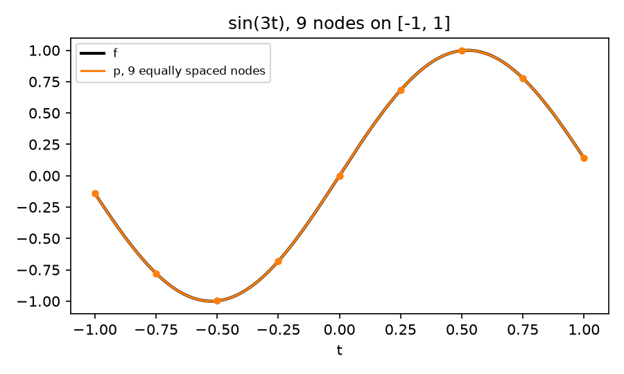
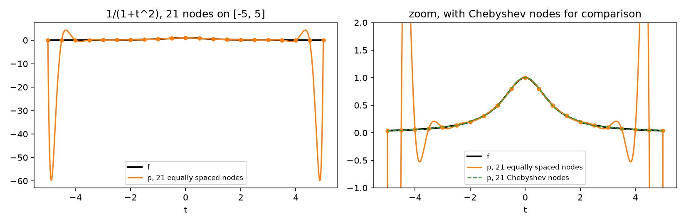

# P12. Dual bases and interpolation (Lecture 1)

Run: `pip install numpy matplotlib`, then `python p12_dual_bases.py`. Full output: [output.txt](output.txt).

`dual_basis(P)` returns the rows of `P⁻¹` (computed by Gauss–Jordan), i.e. the dual basis of the columns of `P`.

**Results**
- Random 5×5 `P`: `r_i · b_j = δ_ij` up to 3e-16, and `x = Σ (r_i x) b_i`.
- Nodes −1, 0, 1: the columns of `V⁻¹` are the Lagrange polynomials `x(x−1)/2`, `1 − x²`, `x(x+1)/2`, because `V ℓ_j = e_j`.
- `sin(3t)`, 9 nodes on [−1, 1]: max error 8.1e-4.
- `1/(1+t²)`, 21 equally spaced nodes on [−5, 5]: max error ≈ 59.8 near the ends (Runge's phenomenon), only 3.3e-3 in the middle. The degree-20 polynomial oscillates wildly between the outer nodes.

