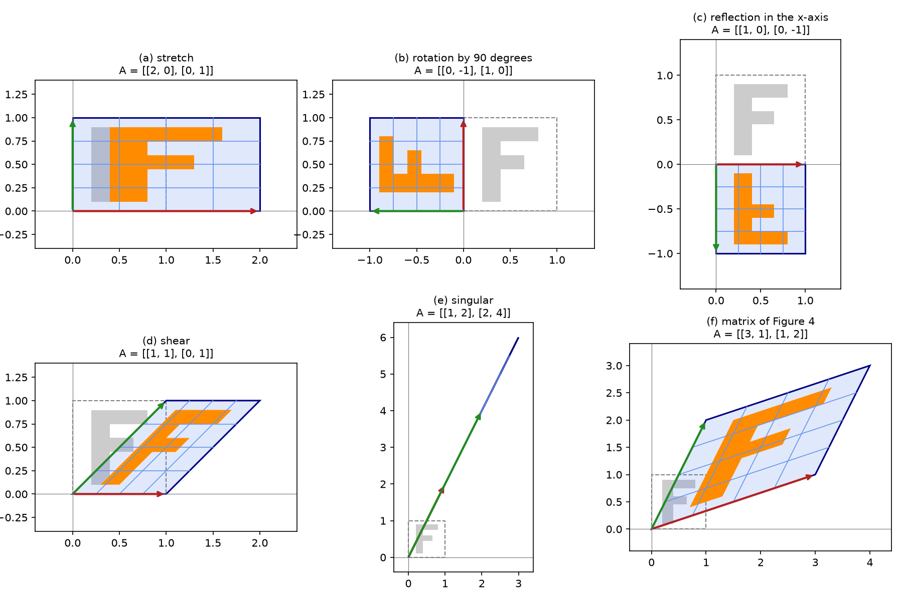

# P6. Visualizing linear transformations (Lecture 1)

Run: `pip install numpy matplotlib`, then `python p6_transformations.py`. Full output: [output.txt](output.txt).

`plot_transformation(A)` draws the unit square, a grid and the letter F before and after `A`; `shoelace_area` computes the signed area of a polygon.

**Results.** The signed area of the image of the unit square equals `det(A)`, including the sign:

| matrix | area | det |
|---|---|---|
| stretch `[[2,0],[0,1]]` | 2 | 2 |
| rotation `[[0,-1],[1,0]]` | 1 | 1 |
| reflection `[[1,0],[0,-1]]` | −1 | −1 |
| shear `[[1,1],[0,1]]` | 1 | 1 |
| singular `[[1,2],[2,4]]` | 0 | 0 |
| `[[3,1],[1,2]]` | 5 | 5 |

The reflection reverses orientation (negative area); the singular matrix squashes the plane onto a line.
