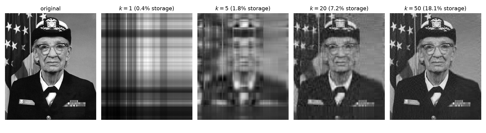
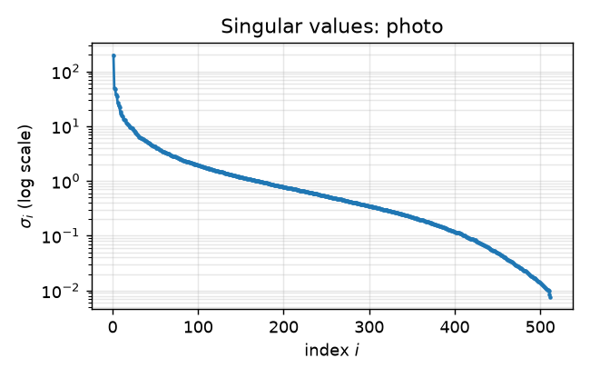

# P10. Image compression with the SVD (Lecture 2)

Run: `pip install numpy matplotlib`, then `python p10_svd_compression.py`. Full output: [output.txt](output.txt).

Two grayscale images: synthetic `sin(x)cos(y) + x/10` (200×300) plus noise, and a photo (Matplotlib sample image, 600×512).

**Results**
- Synthetic: σ₁ = 143.2, σ₂ = 118.2, then a drop to ≈ 1.5 (noise level): the noiseless image has rank 2. Photo: the singular values decay gradually; ranks 6 / 55 / 177 keep 90% / 99% / 99.9% of ‖A‖²_F.
- `‖A − A_k‖_F = sqrt(σ²_{k+1} + … + σ²_r)` exactly (Eckart–Young) for k = 1, 5, 20, 50. Storage ratio `k(m + n + 1)/(mn)`: for the photo, k = 50 needs 18% of the storage.
- `‖A‖₂ = σ₁` and `‖A‖²_F = Σ σᵢ²` (checked for both images).

