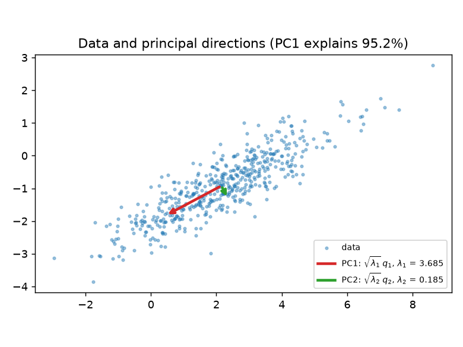
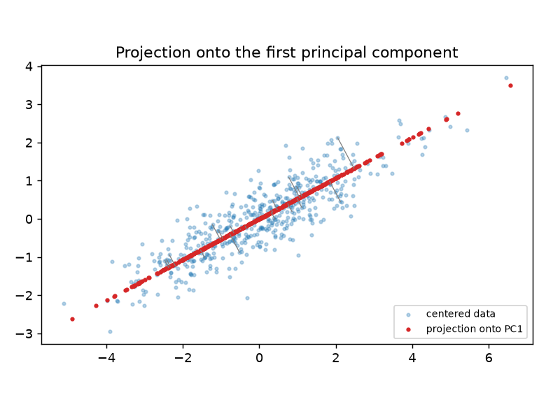
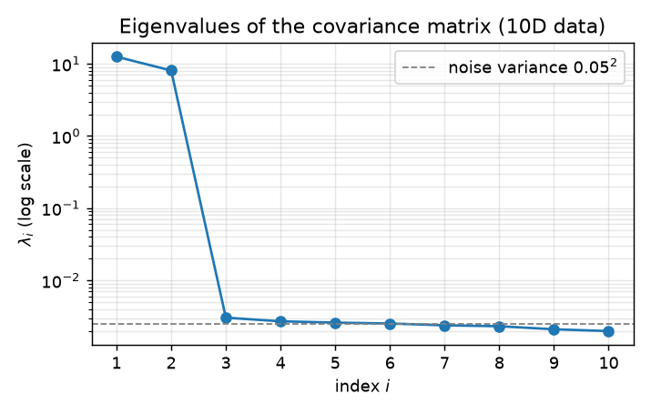

# P11. Principal component analysis (Lecture 2)

Run: `pip install numpy matplotlib`, then `python p11_pca.py`. Full output: [output.txt](output.txt).

**Results**
- 500 points from N((2, −1), C), C = [[3, 1.5], [1.5, 1]]. Eigenvectors of `S = XᵀX/N` and right singular vectors of `X` agree up to sign, and `λᵢ = σᵢ²/N` (λ = 3.685, 0.185). They differ from the eigenvectors of `C` by 0.09°.
- PC1 explains 95.2% of the variance.
- Projection onto PC1: average reconstruction error 0.1846 = λ₂.
- 500 points in ℝ¹⁰ near a 2-dimensional subspace: two large eigenvalues (12.5, 8.1), the other eight ≈ 0.0025 = noise variance 0.05². The gap after the second eigenvalue shows the data is essentially 2-dimensional.

